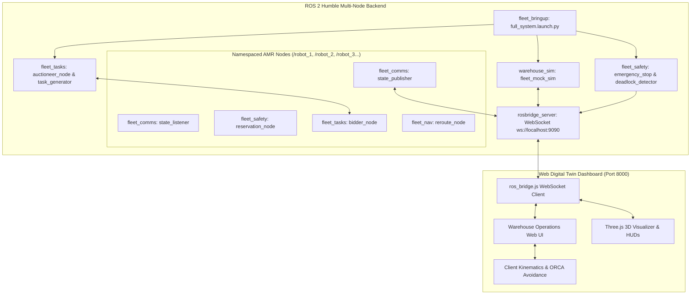

# Autonomous Multi-AMR Warehouse Fleet Coordination & 3D Digital Twin
### Smart India Hackathon (SIH 2026) &middot; Industrial Robotics & Logistics

[](https://docs.ros.org/en/humble/)
[](https://www.python.org/)
[](https://cyclonedds.io/)
[](https://threejs.org/)
[-success.svg)](#installation--setup-guide)

A high-performance, decentralized autonomous mobile robot (AMR) fleet coordination system paired with a real-time, photorealistic Three.js 3D Digital Twin. Built for high-density warehouse environments, it incorporates peer-to-peer (P2P) mesh communications, 6G-telemetry-aware task auctions (Contract Net Protocol), 50 Hz safety collision prevention, ORCA reciprocal avoidance, and dynamic mission dispatch.

---

## Table of Contents
1. [Key Features](#key-features)
2. [System Architecture](#system-architecture)
3. [Repository Directory Structure](#repository-directory-structure)
4. [Installation & Setup Guide](#installation--setup-guide)
   - [Linux / Ubuntu 22.04 LTS (Native)](#1-linux--ubuntu-2204-lts-native-recommended)
   - [Windows Setup (3 Methods)](#2-windows-setup-options)
     - [Method A: WSL2 with Ubuntu 22.04 (Full ROS 2 Stack)](#method-a-windows-subsystem-for-linux-wsl2---recommended-for-full-system)
     - [Method B: Standalone Web Digital Twin (No ROS 2 Required)](#method-b-standalone-web-digital-twin-no-ros-2-required)
     - [Method C: Docker on Windows](#method-c-docker-on-windows)
5. [Running the System](#running-the-system)
6. [Dashboard Features & Controls](#dashboard-features--controls)
7. [ROS 2 Interface & Topics](#ros-2-interface--topics)
8. [Troubleshooting & FAQs](#troubleshooting--faqs)

---

## Key Features

- **Decentralized Multi-AMR Fleet Architecture**: No single point of failure. AMRs communicate over a P2P mesh network for state sync, traffic reservations, and task distribution.
- **Contract Net Protocol (CNP) Auctions with 6G Awareness**: Dynamically allocates warehouse transport orders by factoring in distance, battery capacity, packet loss, and 6G network latency from empirical datasets.
- **50 Hz Safety-Critical Collision Prevention & E-Stop**: Sub-20ms emergency stop response with automatic deadlock detection and proactive intersection reservations.
- **ORCA (Optimal Reciprocal Collision Avoidance)**: Smooth multi-agent collision avoidance preventing bottlenecks in narrow transit corridors and rack aisles.
- **Photorealistic 3D Digital Twin**: High-fidelity Three.js WebGL dashboard displaying live AMR kinematics, pallet racks, Amazon packages, laser guidelines, and battery levels.
- **Live Fleet Comms Command Terminal**: Real-time bidding, arbitration logs, conflict alerts, and operator dispatch logs.
- **Flexible Deployment**: Runs natively on Linux, inside Windows WSL2, or as a standalone client-side simulation on any modern browser.

---

## System Architecture



---

## Repository Directory Structure

```plaintext
sih2026/
├── run_all.sh                 # One-click startup script (Dashboard + ROS 2 stack)
├── ros2_ws/                   # ROS 2 Humble workspace
│   └── src/
│       ├── fleet_bringup/     # System launch files (full_system.launch.py)
│       ├── fleet_comms/       # P2P state pub/sub, comms logging, 6G impairment
│       ├── fleet_msgs/        # Custom messages (TaskAnnouncement, TaskBid, RobotPose, etc.)
│       ├── fleet_nav/         # Reroute node (D* Lite replanning)
│       ├── fleet_safety/      # 50 Hz E-stop, deadlock detector, intersection reservations
│       ├── fleet_tasks/       # Contract Net auctioneer, 6G-aware bidder, task generator
│       └── warehouse_sim/     # Physics mock simulator & navigation highway logic
├── web_sim/                   # Photorealistic Three.js 3D Web Dashboard
│   ├── index.html             # Dashboard UI structure & modals
│   ├── style.css              # Cyberpunk / modern industrial design system
│   ├── main.js                # Three.js 3D scene, AMR meshes, camera & controls
│   ├── warehouse_sim.js       # Client simulation engine, ORCA avoidance & task logic
│   ├── ros_bridge.js          # ROS 2 WebSocket bridge client (rosbridge_server)
│   ├── textures.js            # Canvas procedural textures (caution tape, floors, racks)
│   └── data/                  # Navigation & 6G network telemetry datasets
└── datasets/                  # Industrial warehouse robotics & 6G network datasets
```

---

## Installation & Setup Guide

### 1. Linux / Ubuntu 22.04 LTS (Native) (Recommended)

#### Prerequisites
- Ubuntu 22.04 LTS (Jammy Jellyfish)
- ROS 2 Humble Desktop (`ros-humble-desktop`)
- Python 3.10+
- CycloneDDS RMW implementation

#### Step-by-Step Setup
1. **Install ROS 2 Humble & Dependencies**:
   ```bash
   sudo apt update && sudo apt install -y locales
   sudo locale-gen en_US en_US.UTF-8
   sudo update-locale LC_ALL=en_US.UTF-8 LANG=en_US.UTF-8
   export LANG=en_US.UTF-8

   # Add ROS 2 apt repository
   sudo apt install -y software-properties-common curl
   sudo curl -sSL https://raw.githubusercontent.com/ros/rosdistro/master/ros.key -o /usr/share/keyrings/ros-archive-keyring.gpg
   echo "deb [arch=$(dpkg --print-architecture) signed-by=/usr/share/keyrings/ros-archive-keyring.gpg] http://packages.ros.org/ros2/ubuntu $(. /etc/os-release && echo $UBUNTU_CODENAME) main" | sudo tee /etc/apt/sources.list.d/ros2.list > /dev/null

   sudo apt update
   sudo apt install -y \
       ros-humble-desktop \
       ros-humble-rosbridge-server \
       ros-humble-rmw-cyclonedds-cpp \
       python3-colcon-common-extensions \
       python3-pip \
       psmisc
   ```

2. **Clone and Build the Workspace**:
   ```bash
   cd ~/sih2026/ros2_ws
   source /opt/ros/humble/setup.bash
   colcon build --symlink-install
   ```

3. **Source Workspace**:
   ```bash
   source ~/sih2026/ros2_ws/install/setup.bash
   ```

---

### 2. Windows Setup Options

Running ROS 2 on Windows is supported through three convenient methods:

#### Method A: Windows Subsystem for Linux (WSL2) - Recommended for Full System
WSL2 provides near-native Linux performance with seamless Windows integration. Windows browsers access WSL2 servers directly via `localhost`.

1. **Enable WSL2 in Windows PowerShell (Administrator)**:
   ```powershell
   wsl --install -d Ubuntu-22.04
   ```
   *Reboot your PC if prompted.*

2. **Launch Ubuntu 22.04 Terminal**:
   Open "Ubuntu 22.04" from your Windows Start Menu and set your username and password.

3. **Follow the Linux Setup Steps inside Ubuntu**:
   ```bash
   # Navigate to your workspace (or clone into Ubuntu home)
   cd ~
   git clone <repo-url> sih2026
   cd ~/sih2026

   # Run the Linux setup commands described above:
   sudo apt update && sudo apt install -y ros-humble-desktop ros-humble-rosbridge-server ros-humble-rmw-cyclonedds-cpp python3-colcon-common-extensions psmisc
   
   cd ~/sih2026/ros2_ws
   source /opt/ros/humble/setup.bash
   colcon build --symlink-install
   ```

4. **Launch the System**:
   ```bash
   cd ~/sih2026
   chmod +x run_all.sh
   ./run_all.sh
   ```

5. **Open in Windows**:
   Open **Google Chrome**, **Microsoft Edge**, or **Firefox** inside Windows and navigate to:
   ```
   http://localhost:8000
   ```
   WSL2 automatically routes `localhost` between Windows and Ubuntu. Both the 3D Web Dashboard (`:8000`) and Rosbridge WebSocket (`:9090`) work out of the box!

---

#### Method B: Standalone Web Digital Twin (No ROS 2 Required)
If you are on Windows and want to inspect the 3D warehouse digital twin, test task assignments, test AMR addition/removal, or review collision avoidance without installing ROS 2:

1. **Install Python on Windows**:
   Download and install Python 3.10+ from [python.org](https://www.python.org/downloads/) (ensure *"Add Python to PATH"* is checked).

2. **Open Command Prompt or PowerShell**:
   ```cmd
   cd C:\path\to\sih2026\web_sim
   python -m http.server 8000
   ```

3. **Open Your Browser**:
   Navigate to:
   ```
   http://localhost:8000
   ```
   *Note: In standalone mode, the web digital twin includes client-side autonomous path planning, collision avoidance, inventory manipulation, task generation, and telemetry logging.*

---

#### Method C: Docker on Windows
If you have [Docker Desktop](https://www.docker.com/products/docker-desktop/) installed on Windows:

1. Create a `Dockerfile` in the root directory:
   ```dockerfile
   FROM osrf/ros:humble-desktop
   RUN apt-get update && apt-get install -y \
       ros-humble-rosbridge-server \
       ros-humble-rmw-cyclonedds-cpp \
       python3-colcon-common-extensions \
       psmisc python3-pip
   WORKDIR /workspace
   COPY . /workspace
   RUN /bin/bash -c "source /opt/ros/humble/setup.bash && cd ros2_ws && colcon build --symlink-install"
   EXPOSE 8000 9090
   CMD ["/bin/bash", "./run_all.sh"]
   ```

2. Build and run the container:
   ```cmd
   docker build -t amr-fleet-sim .
   docker run -it --rm -p 8000:8000 -p 9090:9090 amr-fleet-sim
   ```

3. Open `http://localhost:8000` in Windows.

---

## Running the System

To start the full fleet system (Web HTTP server + ROS 2 nodes + Rosbridge WebSocket) in one command:

```bash
cd ~/sih2026
./run_all.sh
```

### What `run_all.sh` Launches:
1. **Web Dashboard Server**: Python HTTP server listening on `http://localhost:8000`.
2. **Rosbridge Server**: WebSocket server on `ws://localhost:9090` bridging ROS 2 topics to Three.js.
3. **Warehouse Simulation Physics**: Autonomous navigation, kinematics, obstacle avoidance.
4. **Safety & Emergency Stop**: 50 Hz monitoring node and deadlock resolver.
5. **Auctioneer & Task Engine**: Contract Net Protocol warehouse logistics dispatcher.
6. **Per-AMR Stacks (`/robot_1`, `/robot_2`, `/robot_3`)**: Namespaced state publishers, peer listeners, reservation managers, and bidders.

Press `Ctrl+C` in the terminal to cleanly terminate all background processes.

---

## Dashboard Features & Controls

### 1. Managing Robots
- **Add Robot**: Click the **"+ Add Robot"** button in the top header. Select either an **ATR-400 Courier** (fast courier) or **ATR-600 Heavy-Lift** (robotic arm). A new AMR is immediately spawned in the warehouse and enrolled into active routing.
- **Remove Robot**:
  - **Option 1 (Header)**: Click **"Remove Robot"** in the top navigation bar to choose any AMR to decommission.
  - **Option 2 (AMR Inspector)**: Click on any robot in the 3D scene or left sidebar to open its telemetry inspector, then click **"🗑️ Remove Robot"**.
  - **Option 3 (Fleet List)**: Click the **"✕"** button on the right edge of any robot card in the left sidebar.

### 2. Task Assignment
- **1-Click Direct Assignment**: Click on any robot to inspect it, then click **"📋 Assign Task"**. The system immediately assigns the nearest warehouse SKU and dispatches the AMR with visual confirmation.
- **Custom Mission Dispatch**: Click **"Create Task"** in the top navigation header to select specific SKUs, target delivery bays (Bay 1 to 4), priority levels (P1 Urgent to P3 Bulk), and targeted AMR units.
- **Dynamic Auction Mode**: Set target to *"Auto-Assign (Auction Manager)"* to let idle AMRs bid via Contract Net Protocol factoring in 6G latency.

### 3. Camera Navigation & Views
- **Orbit 3D**: Left-click and drag across the warehouse.
- **Pan**: Right-click and drag.
- **Zoom**: Scroll wheel.
- **Camera Presets**: Switch instantly between **Overview 3D**, **Follow AMR**, **Top-Down**, and **Workstation**.

### 4. Live P2P Comms Terminal
- Click the **"Terminal"** button on the bottom-right feed to open the full-screen Command Terminal displaying live P2P auction bids, collision resolution logs, and operator dispatch events.

---

## ROS 2 Interface & Topics

| Topic | Type | Description |
|---|---|---|
| `/fleet/task_requests` | `fleet_msgs/TaskAnnouncement` | Warehouse task announcements released for auction |
| `/fleet/task_bids` | `fleet_msgs/TaskBid` | AMR bids factoring in distance, energy, and 6G telemetry |
| `/fleet/task_awards` | `std_msgs/String` | Contract award notifications dispatched to winning AMR |
| `/fleet/manual_task_assignment` | `std_msgs/String` | Operator task dispatch from dashboard to designated AMR |
| `/fleet/safety_events` | `std_msgs/String` | Emergency stops, obstacle warnings, and deadlock alerts |
| `/{robot_id}/fleet/pose` | `fleet_msgs/RobotPose` | 20 Hz real-time position `(x, y, yaw)` and velocity |
| `/{robot_id}/fleet/battery` | `fleet_msgs/BatteryStatus` | Battery percentage, voltage, and health status |
| `/{robot_id}/cmd_vel` | `geometry_msgs/Twist` | Drive velocity commands for manual teleop and navigation |
| `/{robot_id}/scan` | `sensor_msgs/LaserScan` | 2D LiDAR scans for obstacle detection |

---

## Troubleshooting & FAQs

### Q: Port 8000 or 9090 is already in use
Run the following to release the ports:
```bash
fuser -k 8000/tcp 2>/dev/null
fuser -k 9090/tcp 2>/dev/null
```

### Q: Rosbridge status pill shows "Reconnecting..."
1. Ensure `run_all.sh` is active and `rosbridge_websocket` has initialized.
2. Confirm port 9090 is accessible: `curl -i http://localhost:9090`.
3. If running in WSL2, confirm Windows firewall allows inbound connections on ports 8000 and 9090.

### Q: How to switch ROS 2 RMW implementation
By default, the system uses CycloneDDS for optimal multi-robot discovery:
```bash
export RMW_IMPLEMENTATION=rmw_cyclonedds_cpp
```

---

## Authors & Acknowledgments
- Developed for **Smart India Hackathon (SIH 2026)**.
- Specialized in Decentralized Multi-Agent Robotics, 6G Edge Networks, and Photorealistic Industrial Digital Twins.
